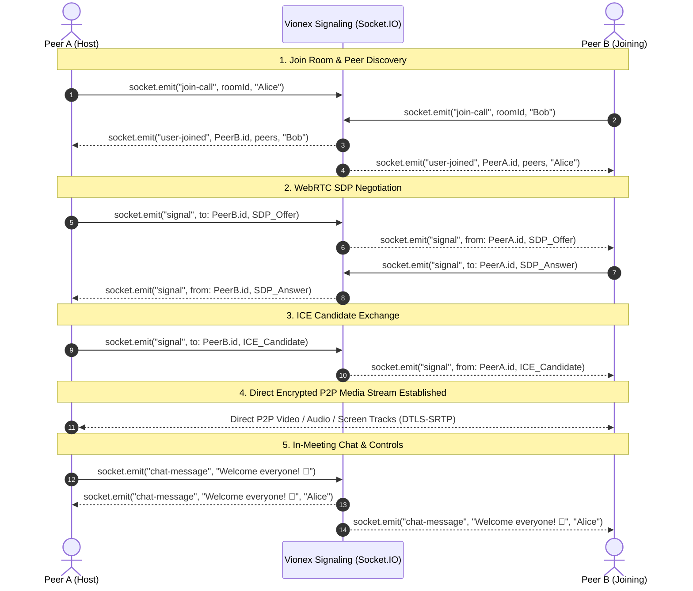
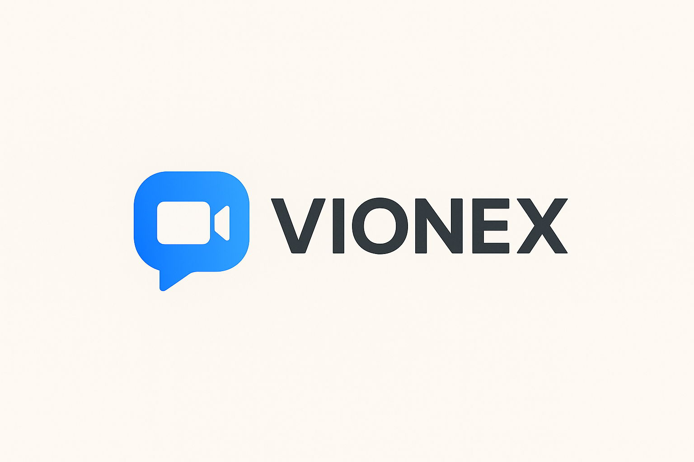

<div align="center">

# ⚡ Vionex — Next-Gen WebRTC Video Conferencing Platform

**A full-stack, real-time video calling and collaboration platform built with React 19, Vite, Express 5, Socket.IO, and MongoDB.**

[](LICENSE)
[](https://react.dev/)
[](https://vitejs.dev/)
[](https://nodejs.org/)
[](https://expressjs.com/)
[](https://socket.io/)
[](https://www.mongodb.com/)
[](https://vercel.com/)

[Explore Codebase](https://github.com/mirjaj-ajij-milon/Vionex) • [Report Issue](https://github.com/mirjaj-ajij-milon/Vionex/issues) • [Vercel Deployment](#-deploying-backend-to-vercel)

<br/>


</div>

---

## 📑 Table of Contents

- [💡 Overview & Key Features](#-overview--key-features)
- [🏛️ System Architecture](#-system-architecture)
- [🔄 Real-Time WebRTC Signaling Flow](#-real-time-webrtc-signaling-flow)
- [📱 Responsive Desktop & Mobile Experience](#-responsive-desktop--mobile-experience)
- [📂 Monorepo Structure](#-monorepo-structure)
- [🚀 Quick Start (Local Setup)](#-quick-start-local-setup)
- [🔐 Simplified Environment Variables (Safe & Easy)](#-simplified-environment-variables-safe--easy)
- [⚡ Deploying Backend to Vercel](#-deploying-backend-to-vercel)
- [🌐 Deploying Frontend to Vercel or Netlify](#-deploying-frontend-to-vercel-or-netlify)
- [🔌 Persistent Signaling Server (Socket.IO Guide)](#-persistent-signaling-server-socketio-guide)
- [📡 REST API Reference](#-rest-api-reference)
- [🧪 Automated Testing](#-automated-testing)
- [🏷️ Recommended GitHub Repository Settings](#-recommended-github-repository-settings)

---

## 💡 Overview & Key Features

**Vionex** is a unified full-stack web application designed for crystal-clear, low-latency audio, video, and screen sharing directly in modern browsers without downloads or third-party plugins.

### ✨ Highlights:
- 🎥 **Multi-User WebRTC Mesh**: Zero-transcoding peer-to-peer audio and video mesh with automatic ICE candidate negotiation.
- 🖥️ **High-Definition Screen Sharing**: 1-click ultra-fluid presentation streaming.
- 💬 **Live In-Meeting Chat**: Real-time room text broadcast with one-tap emoji reaction shortcuts (`❤️ 👍 🚀 ⚡ 🔥 👏`).
- 🚪 **Instant Guest Access**: Generate secure 6-character room codes or join via URL link without mandatory sign-up.
- 🔐 **Hardened Session Auth**: Multi-device login sessions protected with SHA-256 token hashing and bcrypt encryption.
- 📅 **Indexed Call History**: Chronologically sorted meeting history backed by MongoDB compound indexes.
- ⚡ **Vercel Serverless Ready**: Backend equipped with cached MongoDB connection pooling, automated Vercel rewrites, and CORS protection.

---

## 🏛️ System Architecture

```mermaid
graph TB
    subgraph Clients["Frontend Clients (React 19 + Vite)"]
        Host["Host Peer (Browser)"]
        Guest1["Peer 1 (Browser)"]
        Guest2["Peer 2 (Mobile / Tablet)"]
    end

    subgraph BackendServices["Vionex Backend Infrastructure"]
        VercelAPI["Vercel Serverless REST API<br/>(backend/api/index.js)"]
        SocketServer["Persistent Signaling Server<br/>(Node.js + Socket.IO)"]
    end

    subgraph DataStore["Cloud Database"]
        MongoDB[("MongoDB Atlas<br/>(Mongoose 8 Pool)")]
    end

    %% HTTP REST Traffic
    Host -->|POST /api/users/login| VercelAPI
    Guest1 -->|POST /api/users/register| VercelAPI
    Host -->|GET /api/users/get_all_activity| VercelAPI
    VercelAPI -->|Cached Connection| MongoDB

    %% Real-time Signaling Traffic
    Host <-->|WebSocket: SDP & ICE| SocketServer
    Guest1 <-->|WebSocket: SDP & ICE| SocketServer
    Guest2 <-->|WebSocket: SDP & ICE| SocketServer

    %% Direct Peer-to-Peer Media Streams
    Host <===>|Direct WebRTC P2P Media (Audio / Video / Screen)| Guest1
    Host <===>|Direct WebRTC P2P Media (Audio / Video / Screen)| Guest2
    Guest1 <===>|Direct WebRTC P2P Media (Audio / Video / Screen)| Guest2
```

---

## 🔄 Real-Time WebRTC Signaling Flow



---

## 📱 Responsive Desktop & Mobile Experience

<div align="center">
  <table>
    <tr>
      <td align="center"><b>Desktop Command Center (≥ 768px)</b></td>
      <td align="center"><b>Mobile Spotlight & Sheet (< 768px)</b></td>
    </tr>
    <tr>
      <td align="center">
        
      </td>
      <td align="center">
        
      </td>
    </tr>
    <tr>
      <td>Dynamic 2x2 grid, telemetry bar, right chat sidebar, floating capsule dock.</td>
      <td>Spotlight speaker stage, "Peers in Sync" carousel, expandable Live Thread sheet.</td>
    </tr>
  </table>
</div>

---

## 📂 Monorepo Structure

```text
Vionex/
├── backend/                       # Express 5 + Socket.IO + MongoDB
│   ├── api/
│   │   └── index.js               # Vercel serverless function entry point
│   ├── config/
│   │   ├── db.js                  # Cached MongoDB connection pool (Serverless-optimized)
│   │   └── index.js               # Environment config loader (reads .env or process.env)
│   ├── controlers/
│   │   ├── socketManager.js       # WebRTC signaling, room authorization & chat
│   │   └── user.controler.js      # Auth, session tokens & meeting history
│   ├── middleware/
│   │   └── auth.middleware.js     # Strict Header-only Bearer token validator
│   ├── models/
│   │   ├── Meeting.model.js       # Meeting schema with compound index ({ user_id: 1, date: -1 })
│   │   └── user.model.js          # User schema with hashed session tokens
│   ├── routes/
│   │   └── user.routs.js          # REST routes with brute-force rate limiters
│   ├── test/                      # Native node:test suite (Auth, Config, Socket, Server)
│   ├── .env                       # Local developer settings (Ignored by git)
│   ├── .env.example               # Clean template for backend variables
│   ├── index.js                   # Main application instance & CORS security
│   ├── package.json               # Backend dependencies and scripts
│   └── vercel.json                # Vercel rewrites to /api/index.js
│
├── frontend/                      # React 19 + Vite 7 + Material UI
│   ├── public/                    # Static assets & _redirects (SPA routing)
│   ├── src/
│   │   ├── contexts/              # AuthContext & session management
│   │   ├── pages/                 # LandingPage, Authentication, Home, History, VideoMeet
│   │   ├── styles/                # Vanilla CSS modules with obsidian theme tokens
│   │   ├── environment.js         # API and WebSocket URL auto-resolver
│   │   └── main.jsx               # React 19 root with code-split lazy routes
│   ├── test/                      # Frontend unit tests
│   ├── .env                       # Local developer settings (Ignored by git)
│   ├── .env.example               # Clean template for frontend variables
│   ├── index.html                 # Production HTML shell
│   ├── package.json               # Frontend dependencies and scripts
│   └── vite.config.js             # Vite build configuration with vendor chunking
│
├── .env.example                   # Unified root template referencing both apps
├── .gitignore                     # Strict multi-layer protection against secret leaks
├── package.json                   # Root monorepo scripts (dev, test, install:all)
└── README.md                      # Comprehensive project documentation
```

---

## 🚀 Quick Start (Local Setup)

### Prerequisites:
- **Node.js**: v18.0.0 or higher ([Download Node.js](https://nodejs.org/))
- **MongoDB**: Local MongoDB instance (`mongodb://127.0.0.1:27017/vionex`) OR free [MongoDB Atlas](https://www.mongodb.com/atlas) URI.

---

### Step 1: Clone the Repository
```bash
git clone https://github.com/mirjaj-ajij-milon/Vionex.git
cd Vionex
```

### Step 2: Install Dependencies
Install all backend and frontend packages with a single root command:
```bash
npm run install:all
```

### Step 3: Configure Local Environment
Create your local `.env` files from the provided templates:
```bash
# In backend:
cp backend/.env.example backend/.env

# In frontend:
cp frontend/.env.example frontend/.env
```
*(By default, `.env.example` is pre-configured to work immediately with local MongoDB and local ports!)*

### Step 4: Run the Development Servers
Open two terminal tabs:

```bash
# Terminal 1 — Start the Backend (Port 8080):
npm run dev:backend

# Terminal 2 — Start the Frontend (Port 5173):
npm run dev:frontend
```

Visit **`http://localhost:5173`** in your browser. You can now create or join video meetings! 🎉

---

## 🔐 Simplified Environment Variables (Safe & Easy)

We have simplified the environment setup so there is **zero confusion** and **zero risk of leaking secrets**:
- **Local Development**: You only ever need one `backend/.env` and one `frontend/.env`.
- **Production (Vercel / Render / Netlify)**: You never upload or commit `.env` files. You simply enter the variables in the host's web dashboard.
- **Git Protection**: All `.env`, `*.env`, and `.env.*` files are strictly blocked by `.gitignore`. Only `.env.example` templates are tracked.

### 1. Backend Variables (`backend/.env` / Vercel Dashboard)

| Variable | Local Default | Production (Vercel / Render) | Purpose |
| :--- | :--- | :--- | :--- |
| `NODE_ENV` | `development` | `production` | Environment mode |
| `PORT` | `8080` | `8080` *(or auto-assigned)* | Server listening port |
| `MONGO_URL` | `mongodb://127.0.0.1:27017/vionex` | `mongodb+srv://<user>:<pass>@cluster.mongodb.net/vionex` | MongoDB database URI |
| `CLIENT_ORIGIN` | `http://localhost:5173` | `https://your-frontend.vercel.app` | Allowed CORS frontend URL |
| `TURN_URL` | *(Optional)* | *(Optional)* | Optional TURN server for symmetric firewalls |
| `TURN_USERNAME` | *(Optional)* | *(Optional)* | TURN username |
| `TURN_CREDENTIAL` | *(Optional)* | *(Optional)* | TURN credential |

### 2. Frontend Variables (`frontend/.env` / Vercel Dashboard)

| Variable | Local Default | Production (Vercel / Netlify) | Purpose |
| :--- | :--- | :--- | :--- |
| `VITE_API_URL` | `http://localhost:8080` | `https://your-backend.vercel.app` | Backend API & WebSocket endpoint |

---

## ⚡ Deploying Backend to Vercel

The Vionex backend is optimized for **Vercel Serverless Functions**.

### How It Works:
1. `backend/vercel.json` maps all routes to `backend/api/index.js`.
2. `backend/api/index.js` exports the Express app instance.
3. `backend/config/db.js` caches the Mongoose connection globally across warm serverless lambdas.
4. Dynamic CORS automatically accepts Vercel preview URLs (`*.vercel.app`).

### Deploy in 5 Simple Steps:

1. Log in to [vercel.com](https://vercel.com/) and click **"Add New..."** -> **"Project"**.
2. Select your repository: **`mirjaj-ajij-milon/Vionex`**.
3. In **Project Settings**:
   - **Framework Preset**: Select **`Other`**.
   - **Root Directory**: Click **"Edit"** and choose **`backend`**.
4. In **Environment Variables**, add:
   - `NODE_ENV` = `production`
   - `MONGO_URL` = `mongodb+srv://<user>:<password>@cluster.mongodb.net/vionex?retryWrites=true&w=majority`
   - `CLIENT_ORIGIN` = `https://your-frontend.vercel.app`
5. Click **"Deploy"**!

> [!TIP]
> Once deployed, test your API by opening `https://your-backend.vercel.app/` or `https://your-backend.vercel.app/health` in your browser. You will see a `200 OK` health status with database connectivity telemetry.

---

## 🌐 Deploying Frontend to Vercel or Netlify

### Deploying on Vercel:
1. In Vercel, click **"Add New Project"** and select the same **`Vionex`** repository.
2. In **Root Directory**: Click **"Edit"** and choose **`frontend`**.
3. Framework Preset will be automatically detected as **`Vite`**.
4. In **Environment Variables**, add:
   - `VITE_API_URL` = `https://your-backend.vercel.app` (your deployed backend URL)
5. Click **"Deploy"**.

### Deploying on Netlify:
1. Import **`Vionex`** on Netlify.
2. Set **Base directory**: `frontend`.
3. Set **Build command**: `npm run build`.
4. Set **Publish directory**: `frontend/dist`.
5. Add Environment Variable: `VITE_API_URL` = `https://your-backend.vercel.app`.
6. Click **"Deploy"**. (`frontend/public/_redirects` handles SPA client-side routing automatically).

---

## 🔌 Persistent Signaling Server (Socket.IO Guide)

### Serverless vs. Persistent WebSockets:
- **REST APIs on Vercel**: Authentication, login, registration, user meeting history, and health checks run with ultra-fast global serverless routing on Vercel.
- **WebSockets on Vercel**: Vercel Serverless Functions execute per HTTP request (with a 10–15 second max duration) and do not support permanent, bidirectional TCP sockets.
- **Solution**:
  - In local development, `npm run dev` handles both REST and Socket.IO seamlessly together on port 8080.
  - In production, for 24/7 WebRTC signaling, keep your persistent Socket.IO process on a continuous container platform like **Render**, **Railway**, **Fly.io**, or an **Ubuntu VPS**:

### 1-Click Deploy Signaling to Render:
1. Create a free account on [render.com](https://render.com) and click **"New Web Service"**.
2. Connect `https://github.com/mirjaj-ajij-milon/Vionex`.
3. Configure settings:
   - **Root Directory**: `backend`
   - **Build Command**: `npm install`
   - **Start Command**: `npm start`
4. Add Environment Variables:
   - `NODE_ENV` = `production`
   - `MONGO_URL` = your MongoDB Atlas connection string
   - `CLIENT_ORIGIN` = your deployed frontend URL
5. Click **"Create Web Service"**. Render provides a persistent WebSocket signaling URL (e.g. `https://vionex-backend.onrender.com`).

---

## 📡 REST API Reference

All protected endpoints require an `Authorization: Bearer <token>` HTTP header.

| Method | Endpoint | Auth | Description |
| :--- | :--- | :---: | :--- |
| `GET` | `/` | No | API metadata, health status & repository documentation links |
| `GET` | `/health` | No | Health check with database connection state telemetry |
| `POST` | `/api/users/register` | No | Creates a new user account with bcrypt password hashing |
| `POST` | `/api/users/login` | No | Authenticates user & issues a 30-day SHA-256 hashed session |
| `POST` | `/api/users/logout` | Yes | Revokes active session token |
| `GET` | `/api/users/get_all_activity` | Yes | Retrieves paginated user meeting history |
| `POST` | `/api/users/add_to_activity` | Yes | Adds meeting room code to user's history |
| `GET` | `/api/users/ice_config` | No | Returns dynamic STUN & TURN server configurations |

---

## 🧪 Automated Testing

Both backend and frontend feature automated test suites using the Node.js native test runner (`node:test`).

```bash
# Run all tests across the monorepo:
npm test

# Run backend unit & integration tests:
npm run test:backend

# Run frontend tests:
npm run test:frontend

# Verify frontend production build:
npm run build:frontend
```

---

## 🏷️ Recommended GitHub Repository Settings

To make your GitHub repository look professional, copy and paste these settings into your GitHub repository page:

### 📝 Repository Description:
```text
⚡ Next-generation real-time WebRTC video conferencing & collaboration platform. Built with React 19, Vite, Express 5, Socket.IO, and MongoDB. Deployable on Vercel.
```

### 🏷️ Recommended Topics / Tags:
```text
webrtc, video-conferencing, react19, vite, socketio, express5, mongodb, vercel, monorepo, screen-sharing, video-call, fullstack
```

---

## 📄 License & Author

- **Author**: Mirjaj Ajij Milon ([@mirjaj-ajij-milon](https://github.com/mirjaj-ajij-milon))
- **Repository**: [https://github.com/mirjaj-ajij-milon/Vionex](https://github.com/mirjaj-ajij-milon/Vionex)
- **License**: ISC License — open for personal and commercial usage.
