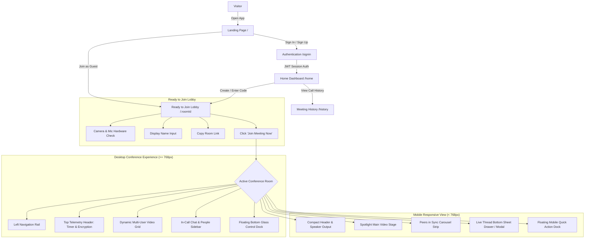

# Vionex — Frontend WebRTC Client Application

> **GitHub Description:** Modern React 19 & Vite video conferencing web application featuring cyber-luxe obsidian aesthetics, peer-to-peer WebRTC mesh calls, screen sharing, and an expandable in-call live thread chat modal with full phone responsiveness.

---

## 🚀 Overview

**Vionex Frontend** is a client application built with **React 19**, **Vite**, and **Material UI**. It delivers high-fidelity peer-to-peer audio/video calling with low latency and visual polish:
- **Cyber-Luxe Obsidian Interface**: Frosted glassmorphism, glowing telemetry indicators, and high-contrast accessible inputs.
- **Pre-Call Ready to Join Lobby**: Live mirrored camera preview with HD 60FPS / latency telemetry, high-visibility device toggles, and 1-click room link sharing.
- **Adaptive Conference Layouts**:
  - **Desktop Command Center**: Left utility rail, top telemetry bar, dynamic 2x2/spotlight grid, integrated chat/people sidebar, and floating control dock with red "End" capsule.
  - **Mobile Responsive View**: Single spotlight speaker stage, horizontal "Peers in Sync" carousel strip with invite card, and an expandable "Live Thread" bottom sheet drawer with 1-click emoji reactions.
- **Real-Time WebRTC Media**: Full-mesh peer negotiation, camera switching, screen sharing, and socket-driven in-call text chat.

---

## 🏛️ Application Architecture & User Flow



---

## 🎨 Design System & Color Tokens

| Token | Color Value | Description |
| :--- | :--- | :--- |
| `--vx-obsidian-bg` | `#090D16` | Main canvas background with ambient indigo glow |
| `--vx-obsidian-surface` | `#0E1320` | Secondary surface background for cards and tiles |
| `--vx-obsidian-card` | `#131926` | Card elevation with 1px glassmorphism border |
| `--vx-neon-emerald` | `#10B981` | Live indicators (`● Speaking`, `Encrypted`, active mic) |
| `--vx-accent-indigo` | `#6366F1` | Primary brand purple/indigo for buttons, "You" message bubbles |
| `--vx-crimson-red` | `#EF4444` | Call termination button and muted hardware states |

---

## 📱 Desktop vs. Mobile Feature Matrix

| Feature | Desktop Command Center (≥ 768px) | Mobile Responsive (< 768px) |
| :--- | :--- | :--- |
| **Left Rail** | Vertical navigation rail (Vionex logo, shortcuts) | Automatically hidden for screen maximization |
| **Video Layout** | Dynamic balanced grid (1, 2, 4+ tiles) | Main spotlight stage + horizontal Peers carousel |
| **Peers Row** | Integrated into main grid | "Peers in Sync" horizontal scrolling track with + Invite |
| **Chat Interface** | Integrated right sidebar (380px) | Expandable "Live Thread" bottom sheet modal |
| **Emoji Reactions** | 1-click emoji bar (`❤️ 👍 🚀 ⚡ 🔥 👏`) | 1-tap emoji bar above mobile composer |
| **Controls Dock** | Floating glass capsule with wide "End" pill | Compact mobile dock with circular red End button |

---

## 🛠️ Tech Stack & Key Libraries

- **Framework**: React 19.x & Vite 7.x
- **Routing**: React Router 7.x (`BrowserRouter`, lazy loading)
- **Real-Time Client**: Socket.IO Client 4.x
- **UI Components & Icons**: Material UI 7.x (`@mui/material`, `@mui/icons-material`)
- **Animations**: Framer Motion 12.x & Custom CSS3 Transitions
- **HTTP Client**: Axios 1.x with automatic Bearer token injection

---

## 🔐 Environment Configuration

Environment settings are controlled via Vite environment variables. Reference `.env.example`:

| Variable | Development Default | Production Default (Netlify) | Description |
| :--- | :--- | :--- | :--- |
| `VITE_API_URL` | `http://localhost:8080` | `https://vionex-backend.onrender.com` | Base URL for REST API & WebSockets |

To set up your local development environment:
```bash
cp .env.example .env.development
```

---

## 🚦 Getting Started

### Prerequisites
- Node.js 18+ (tested on Node 20 / 22)
- Running Vionex Backend server (local or deployed)

### Installation & Run
```bash
# 1. Install dependencies
npm install

# 2. Run local development server (with HMR)
npm run dev

# 3. Execute unit & integration tests
npm test

# 4. Compile optimized production build
npm run build

# 5. Preview production build locally
npm run preview
```
